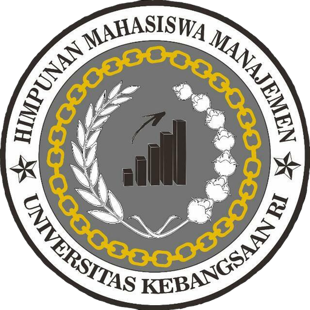

<div align="center">
  

  # HIMMAN UKRI

  **Portal anggota & situs publik Himpunan Mahasiswa Manajemen**
  **Universitas Kebangsaan Republik Indonesia**

  [](https://nextjs.org)
  [](https://www.typescriptlang.org)
  [](https://www.prisma.io)
  [](https://www.postgresql.org)
  [](https://tailwindcss.com)
  [](#lisensi)

  <p>
    <a href="#-fitur">Fitur</a>
  </p>
</div>

---

Satu portal untuk seluruh kegiatan himpunan: kartu anggota digital, event dan sertifikat, iuran kas yang transparan, arsip surat, dan kotak aspirasi. Dibangun dengan Next.js App Router, Prisma, dan PostgreSQL, dengan tema gelap/terang, akses berbasis peran, dan penyimpanan berkas yang bisa lokal maupun cloud.

## ✨ Fitur

### Untuk anggota
- **KTA digital** dengan QR yang bisa diverifikasi siapa pun — scan pakai kamera HP langsung membuka halaman verifikasi
- **Mode check-in layar penuh** dengan Screen Wake Lock; simpan sebagai PNG untuk cadangan
- **Onboarding 5 langkah** sekali saja: lengkapi profil → unggah tanda tangan → kenali KTA → panduan singkat
- **Pendaftaran event** dengan tiket QR, dan unduh sertifikat setelah hadir
- **Iuran kas** — lihat tagihan, unggah bukti transfer, lacak status verifikasi
- **Transparansi kas** — laporan pemasukan/pengeluaran yang sudah diverifikasi
- **Kotak aspirasi anonim** dengan kode pelacakan; tanggapan Komisi III terbaca oleh pengirim

### Untuk pengurus
- **Manajemen anggota**: approve/reject, impor massal dari Excel (mahasiswa baru), kelola KTA
- **Divisi & jabatan**: Kepala Departemen, Sekretaris Departemen, Staf; satu kepala per divisi
- **Pengurus inti**: Ketua, Wakil, Sekretaris Umum, Bendahara Umum, Dewan Pembina, penandatangan eksternal (Ketua Prodi, Dekan, WR III)
- **Izin otomatis** dari jabatan — Ketua Himpunan dapat akses penuh tanpa harus jadi Super Admin
- **Kepanitiaan event**: pembukaan pendaftaran, divisi per event, seleksi, rapat panitia dengan absensi kode, check-in hari-H
- **Sekretariat**: arsip surat masuk/keluar, proposal, LPJ, penomoran otomatis per bulan per jenis, lembar pengesahan bertanda tangan
- **Keuangan double-entry**: bagan akun, jurnal umum, buku besar, neraca, laba rugi, laporan PDF & Excel
- **CMS**: berita, pengumuman, artikel dengan penjadwalan terbit
- **Pintasan admin**: ringkasan berisi antrean tindakan, agenda 30 hari, kondisi kas, dan aktivitas terbaru

### Untuk pengunjung
- Situs publik: profil organisasi, struktur, departemen, dokumen konstitusi, kegiatan, berita
- **Verifikasi sertifikat** — masukkan nomor atau scan QR
- **Verifikasi anggota** — scan QR KTA untuk memastikan keaslian
- **Laporkan bug** dengan info perangkat otomatis, tanpa perlu login


### 📝 Lisensi

- MIT — bebas dipakai dan dimodifikasi dengan mencantumkan atribusi.

### 🙏 Atribusi

- Logo & identitas visual: HIMMAN UKRI

- Font: Archivo & Source Serif (Google Fonts)
```
<div align="center"> <sub>Dibuat dengan ❤️ untuk HIMMAN UKRI · <a href="https://github.com/RISSCoding/org-demo/issues">Laporkan masalah</a></sub> </div>
